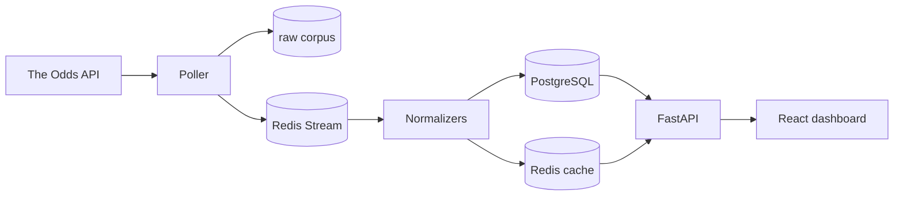

# LineValue

LineValue is a real-time odds analytics platform. It ingests pre-match moneyline odds from dozens of sportsbooks through The Odds API, removes each book's margin to estimate fair probabilities, flags prices that beat the consensus of the other books, and detects **cross-book arbitrage**: games where the best prices across books guarantee a profit whichever side wins. A backtest checks whether flags beat the closing line more often than matched controls.

**Stack:** Python 3.12, FastAPI, asyncio/httpx, PostgreSQL 16, Redis 7 (Streams + cache), React + TypeScript, Docker Compose, k6, OpenAI API

> Status: in development. See [docs/PLAN.md](docs/PLAN.md) for progress. Tables below are filled only from files in [`results/`](results/).

## Results

### Ingestion (live run and replay)

| Sportsbooks | Live-run days | Quotes processed/s (replay, 4 consumers) | Ingest latency p95 |
|---|---|---|---|
| | | | |

### API (k6, 200 VUs, 120 s)

| p50 | p95 | p99 | Error rate |
|---|---|---|---|
| | | | |

### Backtest (test window, frozen threshold)

| Events | Flags | Flagged beat the close | Matched controls beat the close |
|---|---|---|---|
| | | | |

## How it works

Every raw response is saved before processing, so the whole run can be replayed. Normalizers use at-least-once delivery with idempotent writes, so a crash never loses or duplicates a quote. Pricing is deterministic math; the LLM only explains flags, and a validator rejects any explanation with a number that isn't in the data.

Details: [docs/DESIGN.md](docs/DESIGN.md).

## Running it

Setup instructions are added in phase 1. You will need Docker, Python 3.12, Node 20+, and an API key from The Odds API in `.env` (see `.env.example`).

## Project docs

- [docs/SPEC.md](docs/SPEC.md): acceptance criteria
- [docs/DESIGN.md](docs/DESIGN.md): architecture and decisions
- [docs/PLAN.md](docs/PLAN.md): build phases

## Disclaimer

For research and engineering practice only. LineValue does not place bets or give betting advice.
