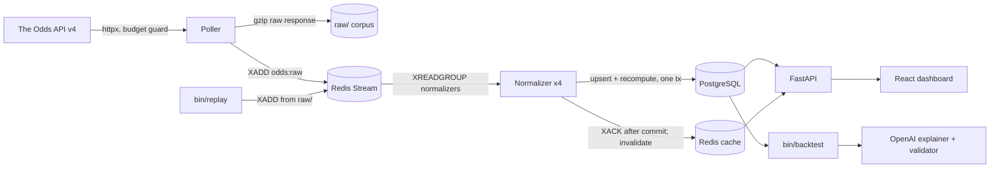

# LineValue Design

## Problem

Sportsbooks price the same game differently, and each price includes a margin (the "vig"). If you remove each book's margin and take the consensus of the other books, you get an estimate of the true probability. A price better than that consensus is a candidate mispricing. The standard test of whether those flags mean anything is **closing-line value**: does the flagged price beat the consensus right before the game starts?

Doing this well is a data-systems problem: many sources, frequent updates, a tight API budget, crash-safe processing, fast reads, and an evaluation that cannot leak future data.

## Goals

- Ingest h2h odds for 4 sports across 4 regions from The Odds API without losing or duplicating data, within the API quota.
- Compute de-vigged, leave-one-out consensus probabilities and flag high-EV quotes as data arrives.
- Serve current markets and flags with low latency to a dashboard.
- Measure the system (throughput, latency) and the model (closing-line value against matched controls) with reproducible scripts.

## Non-goals

- Placing bets, account integration, or betting advice.
- Scraping any website. The Odds API is the only source.
- Spreads, totals, props, live in-play odds (v1 is pre-match h2h).
- Multi-node deployment or Kubernetes. One machine with Docker Compose.
- User accounts. The dashboard is read-only.

## Architecture



| Component | Responsibility |
|---|---|
| **Poller** (`linevalue/poller/`) | One asyncio task per sport. Calls `/v4/sports/{sport}/odds?regions=us,us2,uk,eu&markets=h2h&oddsFormat=decimal`. Writes the gzip body and headers to `raw/YYYY/MM/DD/<sport>-<received_at>.json.gz`, appends to `raw/manifest.jsonl`, then `XADD odds:raw`. Budget guard and backoff live here |
| **Normalizer** (`linevalue/normalizer/`) | Consumer group `normalizers`. Parses a raw response, upserts events, books, and quote changes, recomputes consensus/EV/flags for touched events, commits, invalidates cache keys, then `XACK`. Reclaims stuck messages with `XAUTOCLAIM` |
| **Pricing** (`linevalue/pricing/`) | Pure functions: implied probability, de-vig, leave-one-out median, EV. No I/O, which keeps it property-testable |
| **API** (`linevalue/api/`) | FastAPI. Read-through Redis cache (TTL 5 s) over PostgreSQL |
| **Web** (`web/`) | React + TypeScript + Vite. Flags table and per-book line-movement chart |
| **Tools** (`bin/`) | `live_report`, `replay`, `backtest`, `explain`, `summarize` |

## Data model (PostgreSQL 16)

| Table | Columns | Notes |
|---|---|---|
| `events` | `id` (Odds API event id, PK), `sport`, `home`, `away`, `commence_time` | |
| `books` | `key` (PK), `title` | e.g. `pinnacle`, `draftkings` |
| `raw_responses` | `id`, `sport`, `path`, `received_at`, `committed_at`, `quote_count`, `credits_last`, `credits_remaining` | `[F]` = `committed_at − received_at` |
| `quote_changes` | `event_id`, `book_key`, `outcome`, `price` (numeric), `book_last_update`, `received_at`, `raw_id` | **Unique** (`event_id`, `book_key`, `outcome`, `book_last_update`). Range-partitioned by `received_at` (one partition per day) |
| `latest_quotes` | PK (`event_id`, `book_key`, `outcome`), `price`, `book_last_update` | Current price; makes "did it change?" one lookup |
| `fair_prices` | PK (`event_id`, `book_key`, `outcome`), `fair_p`, `consensus_p`, `ev`, `n_books`, `computed_at` | Recomputed per touched event |
| `flags` | `id`, `event_id`, `book_key`, `outcome`, `price`, `consensus_p`, `ev`, `n_books`, `flagged_at`, `raw_id` | Append-only history used by the backtest |

Idempotency comes from the unique key plus `INSERT ... ON CONFLICT DO NOTHING`, and from updating `latest_quotes` only when `book_last_update` is newer.

## Redis

| Key | Type | Use |
|---|---|---|
| `odds:raw` | Stream | One entry per raw response: `{sport, path, received_at}` (payload stays on disk) |
| group `normalizers` | Consumer group | At-least-once delivery; pending entries list is the crash-recovery log |
| `cache:events`, `cache:event:{id}`, `cache:flags` | String (JSON) | TTL 5 s; deleted by the normalizer after commit |
| `budget:credits` | Hash | Last seen `used`, `remaining`, `last` from response headers |

## Key decisions and trade-offs

| Decision | Why | Alternative considered |
|---|---|---|
| Store raw responses before processing | Enables exact replay (load testing, bug fixes, schema changes) and an audit trail | Process in memory only: smaller, but a parser bug loses data permanently |
| Redis Streams + consumer group | At-least-once delivery, consumer crash recovery (`XAUTOCLAIM`), and horizontal scaling with no extra service | Kafka: industry standard but heavy for one machine; a plain list has no ack or reclaim |
| Idempotent writes instead of exactly-once delivery | Exactly-once across Redis and PostgreSQL needs distributed transactions. Dedup on a natural key is simpler and testable | Outbox/2PC |
| Store only quote changes | Most polls repeat prices; change-only storage cuts write volume and makes line-movement queries cheap | Store every snapshot: simple, but much larger |
| Daily partitions on `quote_changes` | Time-range queries (backtest, charts) prune partitions; old days can be detached | One big table + index |
| Leave-one-out median consensus | A book can't vote for its own price, and the median resists one stale or wild book | Mean (outlier-sensitive); a single "sharp" book (one point of failure) |
| Frozen threshold on a calibration window | Prevents tuning on the test window, the most common backtest leak | Choosing τ on all data |
| Matched controls from the same event and snapshot | Controls share the game, time, and market state, so the comparison isolates the flag | Comparing to 50%: ignores that some prices beat the close by chance or by timing |
| LLM explains, never decides | Flags come from deterministic math; the model only phrases them, and a validator rejects invented numbers | Letting the model rank opportunities: not reproducible, not testable |

## Lessons carried over from Flashpoint

- Measured runs use production settings. Development-mode logging dominated Flashpoint's first benchmark.
- Load generators run inside the Compose network, not through Docker Desktop's published ports.
- Each result file is produced by a script and committed raw; summaries are regenerated, never hand-edited.

## Failure modes

| Failure | Handling | Test |
|---|---|---|
| Normalizer dies after commit, before `XACK` | Message is reclaimed; reprocessing is a no-op thanks to the unique key | F1.4, F1.5 |
| Normalizer dies before commit | Transaction rolls back; message is reclaimed and processed once | F1.5 |
| API returns 429/5xx or times out | Exponential backoff with jitter per sport; other sports continue | F1.6 |
| Quota running low | Budget guard lengthens intervals; polling pauses at 0 remaining | F1.2 |
| Redis restarts | Stream uses AOF (`appendfsync everysec`); poller re-publishes any manifest entries without a `raw_responses` row on startup | Integration test |
| Poller down (laptop asleep) | Gap logged in `results/live/gaps.csv`; reported, not hidden | F1.7 |

## API

| Method | Path | Returns |
|---|---|---|
| GET | `/health` | `{status}` |
| GET | `/events?sport=` | Upcoming events with best price and consensus per outcome |
| GET | `/events/{id}` | Per-book prices, fair probabilities, and line history |
| GET | `/flags?since=` | Current flags sorted by EV |
| GET | `/flags/{id}/explanation` | Validated explanation text, if any |

## Folder structure

```
Line-Value/
├── README.md, AGENTS.md, CLAUDE.md, LICENSE, .env.example, .gitignore
├── docker-compose.yml           postgres, redis, poller, normalizer (x N), api, web
├── pyproject.toml               Python 3.12, ruff, mypy, pytest
├── linevalue/
│   ├── config.py                env settings (pydantic-settings)
│   ├── db/                      SQLAlchemy models, Alembic migrations, partition helper
│   ├── poller/                  odds client, budget guard, backoff, raw writer, publisher
│   ├── normalizer/              consumer loop, parser, upserts, reclaim
│   ├── pricing/                 devig.py, consensus.py, ev.py (pure)
│   ├── api/                     FastAPI app, cache layer, schemas
│   └── explain/                 payload builder, OpenAI client, number validator
├── bin/                         live_report, replay, backtest, explain, summarize
├── web/                         React + TypeScript + Vite dashboard
├── load/api.js                  k6 API load test
├── tests/
│   ├── unit/                    pricing (Hypothesis), budget guard, parser, validator
│   ├── integration/             streams, idempotency, reclaim, cache (Compose services)
│   └── fixtures/                recorded Odds API responses (no live calls in tests)
├── raw/                         captured responses (git-ignored; archive separately)
├── results/                     committed measurements (see results/README.md)
└── .github/workflows/ci.yml
```

## Interview questions this project should prepare you for

1. Why at-least-once plus idempotency instead of exactly-once? What exactly makes a duplicate harmless here?
2. What happens if a normalizer crashes between the PostgreSQL commit and `XACK`? Between parse and commit?
3. How would you scale ingestion to 100× the sources? What breaks first: API quota, stream, database writes, or recompute?
4. Why the median, and why leave-one-out? What happens with only 3 books?
5. How did you prevent leakage in the backtest? Why matched controls instead of a 50% baseline?
6. Why partition `quote_changes` by day? What does partition pruning buy you?
7. How do you keep the cache consistent with the database? What is the staleness bound?
8. Why is the LLM not allowed to decide what gets flagged?
